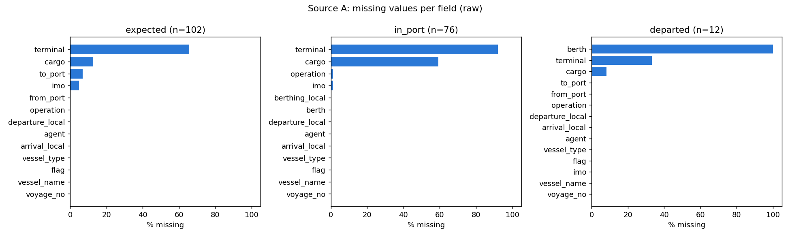
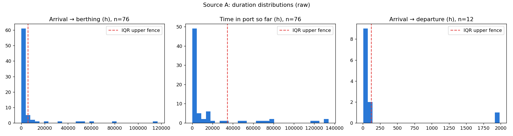
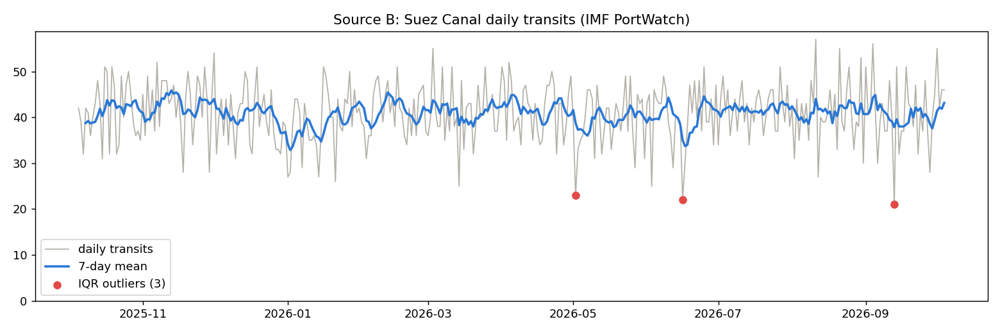
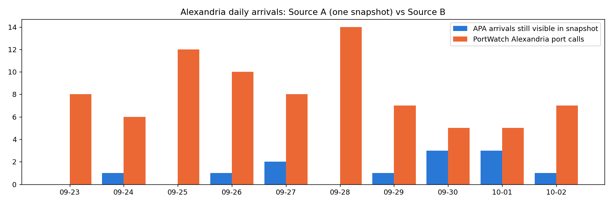

# Data Quality Report — Alexandria Port Authority board (A) & IMF PortWatch (B)

*Generated by `quality/dq_report.py` on 2026-10-06T21:26:57+00:00 · APA snapshot 2026-10-06 21:00 UTC · re-run the script to reproduce every number.*

## 0. Scope and assumptions

- **Source A: Alexandria Port Authority public ship board** (`spsonlinealex.apa.gov.eg`), extracted by `collector/apa_scraper.py`. It has three lists: expected, in-port, departed.
- **Source B: IMF PortWatch** (`collector/fetch_portwatch.py`). Daily Suez Canal transits plus daily port calls for Alexandria, Port Said and Damietta.
  - PortWatch was chosen as the comparison source because it covers Port Said and the Suez Canal *and* overlaps Source A (Alexandria).
  - Global Fishing Watch, the primary Port Said source, was validated separately once its token was obtained: see [gfw-validation.md](gfw-validation.md).
- APA timestamps are **Cairo local time** (`dd/mm/yyyy HH:MM`), converted to UTC with `Africa/Cairo` (DST-aware). PortWatch dates are UTC days.
- Source A is a **single snapshot** of the board's current state, not a history. Statistics describe *today's board*, not a long-run distribution.
- Derived fields:
  - `waiting_h` = berthing − actual arrival
  - `stay_h` = departure − arrival
  - `dwell_so_far_h` = snapshot − arrival
  - `cargo_tons` / `cargo_containers` = parsed from the Arabic cargo text, summing loading and discharge.

## 1. Data extraction

| Source | Method | Records |
|---|---|---|
| A · expected | JSF/PrimeFaces paginated POST (100 rows/page), TLS verified with completed chain | 102 |
| A · in_port | same | 76 |
| A · departed | same | 12 |
| B · Suez daily | ArcGIS REST query | 365 (2025-10-05 → 2026-10-04) |
| B · ports daily | ArcGIS REST query, per port | 1095 (Alexandria: 365, Damietta: 365, Port Said: 365) |

```python
# Source A: one PrimeFaces DataTable page (collector/apa_scraper.py)
session.post(action, headers={"Faces-Request": "partial/ajax"}, data={
    "javax.faces.partial.ajax": "true", "javax.faces.source": table_id,
    f"{table_id}_pagination": "true", f"{table_id}_first": str(first), f"{table_id}_rows": "100",
    "javax.faces.ViewState": view_state, ...})
```

## 2. Data profiling

### Source A — `expected` list
*Semantics:* arrival_local = ETA, departure_local = ETD (announced, not actual).
**Records:** 102 · **Fields:** 15 (incl. `list`, `snapshot_utc`)

**Structure**
| field | pandas dtype | semantic type | non-null | distinct | example |
|---|---|---|---|---|---|
| voyage_no | object | voyage id NNNN/YYYY | 102 | 102 | 3977/2020 |
| vessel_name | object | string (free text) | 102 | 102 | BUNDU |
| imo | object | integer-like | 97 | 97 | 9273014 |
| flag | object | string (categorical) | 102 | 34 | Panama |
| vessel_type | object | string (categorical) | 102 | 16 | Bulk Carrier |
| agent | object | string (free text) | 102 | 50 | المصرية الأوربية للملاحة يوروجيبت |
| arrival_local | object | datetime dd/mm/yyyy HH:MM (Cairo local) | 102 | 102 | 01/01/2021 15:00 |
| departure_local | object | datetime dd/mm/yyyy HH:MM (Cairo local) | 102 | 102 | 15/01/2021 00:00 |
| terminal | object | string (categorical) | 35 | 5 | محطة اسكندرية للحاويات - الدخيلة |
| operation | object | string (categorical) | 102 | 17 | - تفريغ |
| cargo | object | string (free text) | 89 | 85 | - تفريغ 15000 Ton بضائع عامة حديد قطع |
| from_port | object | string (free text) | 102 | 71 | MISURATA.. |
| to_port | object | string (free text) | 95 | 37 | Banjul, Gambia |
| list | object | string (categorical) | 102 | 1 | expected |
| snapshot_utc | object | ISO timestamp | 102 | 1 | 2026-10-06T21:00:34+00:00 |

**First 5 rows** (key columns)
| voyage_no | vessel_name | imo | vessel_type | arrival_local | departure_local |
|---|---|---|---|---|---|
| 3977/2020 | BUNDU | 9273014 | Bulk Carrier | 01/01/2021 15:00 | 15/01/2021 00:00 |
| 3562/2021 | BOUVARESS 2 | <NA> | Fishing Vessel | 11/11/2021 00:00 | 11/11/2021 00:00 |
| 579/2023 | OCMIS GAR | 9141625 | General Cargo | 24/02/2023 00:00 | 28/02/2023 00:00 |
| 1884/2023 | FIDELIS | 9622291 | YACHT | 08/06/2023 07:00 | 09/06/2023 07:00 |
| 2172/2023 | NEBET | <NA> | YACHT | 22/06/2023 16:43 | 23/06/2023 10:35 |

**Numerical statistics** (derived fields; hours/days/tons)
| index | count | mean | median | min | max |
|---|---|---|---|---|---|
| eta_age_days | 102.00 | 146.65 | -2.33 | -13.59 | 2,104.33 |
| cargo_tons | 102.00 | 8,701.26 | 2,000.00 | 0.00 | 69,926.56 |
| cargo_containers | 102.00 | 190.77 | 0.00 | 0.00 | 1,600.00 |

**Categorical frequencies**
| field | top values (count) |
|---|---|
| vessel_type | Container (34), General Cargo (27), Bulk… |
| flag | Panama (15), Liberia (12), Malta (8), Po… |
| operation | - شحن - تفريغ (32), - تفريغ (19), - تفري… |
| terminal | <NA> (67), محطة اسكندرية للحاويات - اسكن… |
| pw_class | container (34), general_cargo (27), dry_… |

### Source A — `in_port` list
*Semantics:* arrival_local = actual arrival (ATA), departure_local = expected departure, berthing_local = actual berthing.
**Records:** 76 · **Fields:** 15 (incl. `list`, `snapshot_utc`)

**Structure**
| field | pandas dtype | semantic type | non-null | distinct | example |
|---|---|---|---|---|---|
| voyage_no | object | voyage id NNNN/YYYY | 76 | 76 | 3829/2026 |
| vessel_name | object | string (free text) | 76 | 76 | DODO |
| imo | object | integer-like | 75 | 75 | 8322040 |
| flag | object | string (free text) | 76 | 27 | Togo |
| vessel_type | object | string (categorical) | 76 | 21 | General Cargo |
| agent | object | string (free text) | 76 | 51 | البسمة للتوكيلات الملاحية و خدمات النقل |
| arrival_local | object | datetime dd/mm/yyyy HH:MM (Cairo local) | 76 | 75 | 03/10/2026 14:15 |
| departure_local | object | datetime dd/mm/yyyy HH:MM (Cairo local) | 76 | 76 | 22/10/2026 16:23 |
| terminal | object | string (categorical) | 6 | 4 | محطة اسكندرية للحاويات - اسكندرية |
| operation | object | string (free text) | 75 | 29 | - شحن - تفريغ |
| cargo | object | string (free text) | 31 | 31 | - شحن 4500 Ton بضائع عامة سكر معبأ - تفر… |
| berth | object | string (free text) | 76 | 45 | 10 |
| berthing_local | object | datetime dd/mm/yyyy HH:MM (Cairo local) | 76 | 74 | 05/10/2026 07:55 |
| list | object | string (categorical) | 76 | 1 | in_port |
| snapshot_utc | object | ISO timestamp | 76 | 1 | 2026-10-06T21:00:34+00:00 |

**First 5 rows** (key columns)
| voyage_no | vessel_name | imo | vessel_type | arrival_local | departure_local | berth | berthing_local |
|---|---|---|---|---|---|---|---|
| 3829/2026 | DODO | 8322040 | General Cargo | 03/10/2026 14:15 | 22/10/2026 16:23 | 10 | 05/10/2026 07:55 |
| 3749/2026 | TIMBERLAND | 9204790 | General Cargo | 30/09/2026 17:30 | 20/10/2026 18:00 | 14 | 30/09/2026 20:05 |
| 3856/2026 | BBC CLARA | 9810355 | General Cargo | 06/10/2026 05:00 | 06/11/2026 01:00 | 15 | 06/10/2026 12:35 |
| 3955/2026 | KERIR 3 | 8220022 | Tug | 06/10/2026 12:30 | 07/10/2026 11:15 | 19 | 06/10/2026 14:00 |
| 3895/2026 | ORIENTAL | 9085077 | General Cargo | 01/10/2026 11:30 | 15/10/2026 11:44 | 2 | 05/10/2026 07:35 |

**Numerical statistics** (derived fields; hours/days/tons)
| index | count | mean | median | min | max |
|---|---|---|---|---|---|
| waiting_h | 76.00 | 6,677.34 | 87.33 | 1.17 | 116,689.00 |
| dwell_so_far_h | 76.00 | 16,415.49 | 1,858.93 | 8.68 | 134,071.01 |
| cargo_tons | 76.00 | 9,954.29 | 0.00 | 0.00 | 165,779.00 |
| cargo_containers | 76.00 | 26.57 | 0.00 | 0.00 | 1,146.00 |

**Categorical frequencies**
| field | top values (count) |
|---|---|
| vessel_type | General Cargo (17), Bulk Carrier (12), T… |
| flag | Egypt (15), Panama (6), Togo (5), Marsha… |
| operation | - إصلاح (22), - تفريغ (9), - تفريغ - سحب… |
| berth | ترسانة 1 (12), جانب الحوض العائم (5), ال… |
| terminal | <NA> (70), محطة اسكندرية للحاويات - اسكن… |
| pw_class | NULL (30), general_cargo (20), dry_bulk … |

### Source A — `departed` list
*Semantics:* arrival_local = actual arrival, departure_local = actual departure.
**Records:** 12 · **Fields:** 16 (incl. `list`, `snapshot_utc`)

**Structure**
| field | pandas dtype | semantic type | non-null | distinct | example |
|---|---|---|---|---|---|
| voyage_no | object | voyage id NNNN/YYYY | 12 | 12 | 2778/2026 |
| vessel_name | object | string (categorical) | 12 | 12 | HTM VANGUARD |
| imo | object | integer-like | 12 | 12 | 9704453 |
| flag | object | string (categorical) | 12 | 10 | Marshall Islands |
| vessel_type | object | string (categorical) | 12 | 4 | Chemical Tanker |
| agent | object | string (categorical) | 12 | 10 | شركة البحرية للاعمال الملاحية |
| arrival_local | object | datetime dd/mm/yyyy HH:MM (Cairo local) | 12 | 12 | 15/07/2026 15:30 |
| departure_local | object | datetime dd/mm/yyyy HH:MM (Cairo local) | 12 | 12 | 06/10/2026 07:15 |
| berth | object | empty | 0 | 0 |  |
| terminal | object | string (categorical) | 8 | 4 | محطة تحيا مصر 1 - اسكندرية |
| operation | object | string (categorical) | 12 | 4 | - تفريغ |
| cargo | object | string (categorical) | 11 | 11 | - تفريغ 30000 Ton صب سائل مازوت |
| from_port | object | string (categorical) | 12 | 11 | Gibraltar |
| to_port | object | string (categorical) | 12 | 10 | TO ORDER |
| list | object | string (categorical) | 12 | 1 | departed |
| snapshot_utc | object | ISO timestamp | 12 | 1 | 2026-10-06T21:00:34+00:00 |

**First 5 rows** (key columns)
| voyage_no | vessel_name | imo | vessel_type | arrival_local | departure_local | berth |
|---|---|---|---|---|---|---|
| 2778/2026 | HTM VANGUARD | 9704453 | Chemical Tanker | 15/07/2026 15:30 | 06/10/2026 07:15 | <NA> |
| 3845/2026 | BUXLINK | 9235816 | Container | 01/10/2026 21:50 | 06/10/2026 03:25 | <NA> |
| 3860/2026 | ATLANTIC EXPRESS | 9330850 | Container | 05/10/2026 20:00 | 06/10/2026 02:00 | <NA> |
| 3887/2026 | ERK IZMIR | 9179983 | Vehicles Carrier | 05/10/2026 18:00 | 06/10/2026 06:40 | <NA> |
| 3820/2026 | EGY FUTURE | 9127538 | Container | 01/10/2026 11:25 | 06/10/2026 10:25 | <NA> |

**Numerical statistics** (derived fields; hours/days/tons)
| index | count | mean | median | min | max |
|---|---|---|---|---|---|
| stay_h | 12.00 | 200.74 | 31.12 | 6.00 | 1,983.75 |
| cargo_tons | 12.00 | 3,947.60 | 0.00 | 0.00 | 30,000.00 |
| cargo_containers | 12.00 | 433.42 | 385.00 | 0.00 | 1,100.00 |

**Categorical frequencies**
| field | top values (count) |
|---|---|
| vessel_type | Container (8), Vehicles Carrier (2), Che… |
| flag | Malta (2), Panama (2), Liberia (1), Mars… |
| operation | - شحن - تفريغ (7), - تفريغ (3), - شحن - … |
| berth | <NA> (12) |
| terminal | <NA> (4), محطة اسكندرية للحاويات - اسكند… |
| pw_class | container (8), roro (2), tanker (1), NUL… |


### Source B — IMF PortWatch

**Structure**
| table | field | pandas dtype | semantic type | non-null | distinct | example |
|---|---|---|---|---|---|---|
| suez_daily | date | object | string (free text) | 365 | 365 | 2025-10-05 |
| suez_daily | n_total | int64 | integer-like | 365 | 36 | 42 |
| suez_daily | n_container | int64 | integer-like | 365 | 17 | 10 |
| suez_daily | n_tanker | int64 | integer-like | 365 | 25 | 15 |
| suez_daily | n_dry_bulk | int64 | integer-like | 365 | 21 | 13 |
| suez_daily | n_general_cargo | int64 | integer-like | 365 | 12 | 4 |
| suez_daily | n_roro | int64 | integer-like | 365 | 6 | 0 |
| ports_daily | date | object | string (categorical) | 1095 | 365 | 2025-10-03 |
| ports_daily | portname | object | string (categorical) | 1095 | 3 | Alexandria |
| ports_daily | country | object | string (categorical) | 1095 | 1 | Egypt |
| ports_daily | portcalls | int64 | integer-like | 1095 | 28 | 14 |
| ports_daily | portcalls_container | int64 | integer-like | 1095 | 10 | 3 |
| ports_daily | portcalls_tanker | int64 | integer-like | 1095 | 7 | 2 |
| ports_daily | portcalls_dry_bulk | int64 | integer-like | 1095 | 9 | 3 |

**First 5 rows: suez_daily**
| date | n_total | n_container | n_tanker | n_dry_bulk | n_general_cargo | n_roro |
|---|---|---|---|---|---|---|
| 2025-10-05 | 42 | 10 | 15 | 13 | 4 | 0 |
| 2025-10-06 | 39 | 9 | 13 | 10 | 7 | 0 |
| 2025-10-07 | 32 | 8 | 14 | 7 | 3 | 0 |
| 2025-10-08 | 42 | 7 | 13 | 15 | 7 | 0 |
| 2025-10-09 | 41 | 15 | 15 | 8 | 3 | 0 |

**First 5 rows: ports_daily**
| date | portname | country | portcalls | portcalls_container | portcalls_tanker | portcalls_dry_bulk |
|---|---|---|---|---|---|---|
| 2025-10-03 | Alexandria | Egypt | 14 | 3 | 2 | 3 |
| 2025-10-03 | Damietta | Egypt | 6 | 4 | 0 | 1 |
| 2025-10-03 | Port Said | Egypt | 3 | 2 | 0 | 0 |
| 2025-10-04 | Alexandria | Egypt | 11 | 4 | 1 | 0 |
| 2025-10-04 | Damietta | Egypt | 3 | 3 | 0 | 0 |

**Numerical statistics**
| index | table | count | mean | median | min | max |
|---|---|---|---|---|---|---|
| n_total | suez_daily | 365.00 | 40.93 | 41.00 | 21.00 | 57.00 |
| n_container | suez_daily | 365.00 | 9.14 | 9.00 | 1.00 | 17.00 |
| n_tanker | suez_daily | 365.00 | 15.97 | 16.00 | 4.00 | 29.00 |
| n_dry_bulk | suez_daily | 365.00 | 10.76 | 10.00 | 1.00 | 21.00 |
| n_general_cargo | suez_daily | 365.00 | 4.03 | 4.00 | 0.00 | 14.00 |
| n_roro | suez_daily | 365.00 | 1.04 | 1.00 | 0.00 | 5.00 |
| Alexandria | ports_daily (portcalls) | 365.00 | 9.75 | 9.00 | 0.00 | 30.00 |
| Damietta | ports_daily (portcalls) | 365.00 | 6.94 | 7.00 | 0.00 | 18.00 |
| Port Said | ports_daily (portcalls) | 365.00 | 2.15 | 2.00 | 0.00 | 6.00 |

## 3. Data quality checks

### 3.1 Missing values (Source A)


**expected**

| field | missing | missing % |
|---|---|---|
| voyage_no | 0 | 0.00 |
| vessel_name | 0 | 0.00 |
| imo | 5 | 4.90 |
| flag | 0 | 0.00 |
| vessel_type | 0 | 0.00 |
| agent | 0 | 0.00 |
| arrival_local | 0 | 0.00 |
| departure_local | 0 | 0.00 |
| terminal | 67 | 65.70 |
| operation | 0 | 0.00 |
| cargo | 13 | 12.70 |
| from_port | 0 | 0.00 |
| to_port | 7 | 6.90 |
| list | 0 | 0.00 |
| snapshot_utc | 0 | 0.00 |

**in_port**

| field | missing | missing % |
|---|---|---|
| voyage_no | 0 | 0.00 |
| vessel_name | 0 | 0.00 |
| imo | 1 | 1.30 |
| flag | 0 | 0.00 |
| vessel_type | 0 | 0.00 |
| agent | 0 | 0.00 |
| arrival_local | 0 | 0.00 |
| departure_local | 0 | 0.00 |
| terminal | 70 | 92.10 |
| operation | 1 | 1.30 |
| cargo | 45 | 59.20 |
| berth | 0 | 0.00 |
| berthing_local | 0 | 0.00 |
| list | 0 | 0.00 |
| snapshot_utc | 0 | 0.00 |

**departed**

| field | missing | missing % |
|---|---|---|
| voyage_no | 0 | 0.00 |
| vessel_name | 0 | 0.00 |
| imo | 0 | 0.00 |
| flag | 0 | 0.00 |
| vessel_type | 0 | 0.00 |
| agent | 0 | 0.00 |
| arrival_local | 0 | 0.00 |
| departure_local | 0 | 0.00 |
| berth | 12 | 100.00 |
| terminal | 4 | 33.30 |
| operation | 0 | 0.00 |
| cargo | 1 | 8.30 |
| from_port | 0 | 0.00 |
| to_port | 0 | 0.00 |
| list | 0 | 0.00 |
| snapshot_utc | 0 | 0.00 |


Source B: 0 missing cells in suez_daily, 0 in ports_daily. Missing **days** in the calendar are counted in 3.2.

### 3.2 Duplicates, format, logic (rule checks)

**Source A**
**expected**

| check | result |
|---|---|
| exact_duplicates | 0 |
| duplicate_voyage_no | 0 |
| duplicate_imo | 0 |
| bad_voyage_format | 0 |
| invalid_imo_checkdigit | 0 |
| missing_imo | 5 |
| name_not_upper_latin | 0 |
| bad_date_format:arrival_local | 0 |
| unparseable_date:arrival_local | 0 |
| bad_date_format:departure_local | 0 |
| unparseable_date:departure_local | 0 |
| departure_before_arrival | 0 |
| voyage_year_vs_arrival_year_gap>1 | 0 |
| local_craft (Egypt flag, placeholder IMO… | 0 |
| stale_eta_older_than_7d | 27 |
| eta_year_before_2026 | 14 |
| rows | 102 |

**in_port**

| check | result |
|---|---|
| exact_duplicates | 0 |
| duplicate_voyage_no | 0 |
| duplicate_imo | 0 |
| bad_voyage_format | 0 |
| invalid_imo_checkdigit | 11 |
| missing_imo | 1 |
| name_not_upper_latin | 6 |
| bad_date_format:arrival_local | 0 |
| unparseable_date:arrival_local | 0 |
| bad_date_format:departure_local | 0 |
| unparseable_date:departure_local | 0 |
| bad_date_format:berthing_local | 0 |
| unparseable_date:berthing_local | 0 |
| departure_before_arrival | 1 |
| voyage_year_vs_arrival_year_gap>1 | 0 |
| berthing_before_arrival | 0 |
| arrival_in_future | 0 |
| berthing_missing | 0 |
| at_inner_anchorage (berth = مخطاف, live … | 1 |
| at_shipyard_or_repair_berth | 23 |
| expected_departure_already_passed (stale… | 43 |
| long_stay_arrival_older_than_60d (never-… | 40 |
| arrival_year_before_2026 | 26 |
| local_craft (Egypt flag, placeholder IMO… | 10 |
| rows | 76 |

**departed**

| check | result |
|---|---|
| exact_duplicates | 0 |
| duplicate_voyage_no | 0 |
| duplicate_imo | 0 |
| bad_voyage_format | 0 |
| invalid_imo_checkdigit | 0 |
| missing_imo | 0 |
| name_not_upper_latin | 0 |
| bad_date_format:arrival_local | 0 |
| unparseable_date:arrival_local | 0 |
| bad_date_format:departure_local | 0 |
| unparseable_date:departure_local | 0 |
| departure_before_arrival | 0 |
| voyage_year_vs_arrival_year_gap>1 | 0 |
| local_craft (Egypt flag, placeholder IMO… | 0 |
| departure_in_future | 0 |
| rows | 12 |


**Source B**
**suez_daily**

| check | result |
|---|---|
| rows | 365 |
| unparseable_dates | 0 |
| duplicate_keys | 0 |
| negative_counts | 0 |
| sum(parts) > n_total | 0 |
| missing_calendar_days | 0 |

**ports_daily**

| check | result |
|---|---|
| rows | 1095 |
| unparseable_dates | 0 |
| duplicate_keys | 0 |
| negative_counts | 0 |
| sum(parts) > portcalls | 0 |
| missing_calendar_days | 0 |


```python
def imo_valid(x):   # IMO check digit: weights 7..2 on the first six digits
    s = str(x)
    return bool(re.fullmatch(r"\d{7}", s)) and sum(int(d) * w for d, w in zip(s[:6], range(7, 1, -1))) % 10 == int(s[6])
```

### 3.3 Outliers (IQR fences 1.5×IQR; z-score |z| > 3)
| list | field | n | q1 | q3 | iqr_low | iqr_high | iqr_outliers | z_outliers(|z|>3) |
|---|---|---|---|---|---|---|---|---|
| in_port | waiting_h | 76 | 3.02 | 2,297.08 | -3,438.07 | 5,738.18 | 15 | 2 |
| in_port | dwell_so_far_h | 76 | 159.07 | 13,864.51 | -20,399.08 | 34,422.67 | 12 | 4 |
| in_port | cargo_tons | 76 | 0.00 | 5,713.63 | -8,570.45 | 14,284.09 | 11 | 2 |
| departed | stay_h | 12 | 14.27 | 57.02 | -49.85 | 121.15 | 1 | 1 |
| departed | cargo_tons | 12 | 0.00 | 1,400.00 | -2,100.00 | 3,500.00 | 2 | 1 |
| expected | cargo_tons | 102 | 0.00 | 9,180.07 | -13,770.11 | 22,950.18 | 15 | 5 |
| PortWatch suez | n_total | 365 | 37.00 | 45.00 | 25.00 | 57.00 | 3 | 1 |
| PortWatch Alexandria | portcalls | 365 | 7.00 | 12.00 | -0.50 | 19.50 | 15 | 6 |
| PortWatch Port Said | portcalls | 365 | 1.00 | 3.00 | -2.00 | 6.00 | 0 | 0 |
| PortWatch Damietta | portcalls | 365 | 5.00 | 9.00 | -1.00 | 15.00 | 2 | 2 |

Longest current stays in port (Source A, in_port). Note the **records open since 2011–2017**:
| vessel_name | vessel_type | arrival_local | berthing_local | dwell_so_far_h |
|---|---|---|---|---|
| MISR GULF IX | Offshore Tug / Supply Ship | 21/06/2011 16:00 | 21/06/2011 17:35 | 134,071.01 |
| SUB SEA99 | Offshore Tug / Supply Ship | 21/10/2011 08:05 | 21/10/2011 10:55 | 131,150.93 |
| NUWAYBA | Ro-Ro Cargo Ship | 30/11/2012 14:30 | 19/02/2022 13:30 | 121,400.51 |
| NSSC 1 | Barge Carrier | 02/05/2013 18:00 | 24/08/2026 20:00 | 117,725.01 |
| جواد | Offshore Tug / Supply Ship | 14/11/2017 15:45 | 15/11/2017 00:40 | 77,959.26 |
| OASIS 1 | Oil Tanker | 22/12/2017 21:00 | 28/03/2020 18:55 | 77,042.01 |

**Interpretation:**
- The raw `waiting_h` distribution is dominated by never-closed records and by ships whose `berthing_local` is the **latest** berth move (e.g. NUWAYBA: arrived 2012, "berthed" 2022).
- After removing long stays (> 60 d), local craft and shipyard/service berths, the analytical view is:
| index | count | mean | median | min | max |
|---|---|---|---|---|---|
| arrival → berthing (h), analytical view | 26.00 | 124.13 | 24.17 | 1.50 | 1,055.58 |

**Berth classes** (the board mixes numbered quays, named quays, shipyards and the anchorage):
| berth_class | ships |
|---|---|
| quay | 50 |
| shipyard_repair | 23 |
| services | 2 |
| anchorage | 1 |




### 3.4 Referential integrity (Source A)

- A voyage should be in exactly one state (expected, in port, or departed).

| pair | shared voyage_no |
|---|---|
| expected ∩ in_port | 0 |
| expected ∩ departed | 0 |
| in_port ∩ departed | 0 |

- IMO → vessel name must be 1:1 across lists. Conflicts found: **0** rows.


## 4. Data correction

Raw Bronze files are never modified. Corrections produce **Silver** tables (`data/silver/*.parquet`) with flags, so every change is auditable.

| table | action | rows affected | justification |
|---|---|---|---|
| expected | Normalized names (upper case, single spa… | 102 | Same vessel/port must compare equal acro… |
| expected | Invalid IMO (check digit) → NULL + imo_v… | 0 | An IMO failing its check digit is a typo… |
| expected | Removed duplicate rows (same voyage_no +… | 0 | Same port call listed twice |
| expected | Flagged + excluded stale announcements (… | 27 | Records 2020–2026 never closed by the op… |
| expected | terminal NULL → 'NO_TERMINAL' | 67 | Structural missingness: only container-t… |
| expected | departure earlier than arrival → departu… | 0 | Data-entry error (e.g. STAR LIGHT: ETD 3… |
| expected | Flagged local craft (`is_local_craft`), … | 0 | Domestic barges/tugs/dredgers have no IM… |
| expected | cargo_tons: flagged IQR outliers, added … | 15 | Long stays are real (e.g. tankers at lay… |
| expected | Missing IMO left NULL (not imputed) | 5 | Identifiers cannot be imputed without fa… |
| in_port | Normalized names (upper case, single spa… | 76 | Same vessel/port must compare equal acro… |
| in_port | Invalid IMO (check digit) → NULL + imo_v… | 11 | An IMO failing its check digit is a typo… |
| in_port | Removed duplicate rows (same voyage_no +… | 0 | Same port call listed twice |
| in_port | terminal NULL → 'NO_TERMINAL' | 70 | Structural missingness: only container-t… |
| in_port | waiting_h < 0 (berthing before arrival) … | 0 | Impossible ordering = data-entry error; … |
| in_port | departure earlier than arrival → departu… | 1 | Data-entry error (e.g. STAR LIGHT: ETD 3… |
| in_port | Flagged local craft (`is_local_craft`), … | 10 | Domestic barges/tugs/dredgers have no IM… |
| in_port | Flagged long stays (arrival > 60 d ago, … | 40 | Records open since 2011–2017 are laid-up… |
| in_port | waiting_h → NULL for shipyard/repair/ser… | 25 | Ships at repair yards are not waiting fo… |
| in_port | waiting_h: flagged IQR outliers, added w… | 3 | Long stays are real (e.g. tankers at lay… |
| in_port | dwell_so_far_h: flagged IQR outliers, ad… | 12 | Long stays are real (e.g. tankers at lay… |
| in_port | cargo_tons: flagged IQR outliers, added … | 11 | Long stays are real (e.g. tankers at lay… |
| in_port | Missing IMO left NULL (not imputed) | 12 | Identifiers cannot be imputed without fa… |
| departed | Normalized names (upper case, single spa… | 12 | Same vessel/port must compare equal acro… |
| departed | Invalid IMO (check digit) → NULL + imo_v… | 0 | An IMO failing its check digit is a typo… |
| departed | Removed duplicate rows (same voyage_no +… | 0 | Same port call listed twice |
| departed | terminal NULL → 'NO_TERMINAL' | 4 | Structural missingness: only container-t… |
| departed | stay_h < 0 (departure before arrival) → … | 0 | Impossible ordering = data-entry error; … |
| departed | departure earlier than arrival → departu… | 0 | Data-entry error (e.g. STAR LIGHT: ETD 3… |
| departed | Flagged local craft (`is_local_craft`), … | 0 | Domestic barges/tugs/dredgers have no IM… |
| departed | stay_h: flagged IQR outliers, added wins… | 1 | Long stays are real (e.g. tankers at lay… |
| departed | cargo_tons: flagged IQR outliers, added … | 2 | Long stays are real (e.g. tankers at lay… |
| departed | Missing IMO left NULL (not imputed) | 0 | Identifiers cannot be imputed without fa… |
| portwatch_suez | Removed duplicate (date[, port]) rows | 0 | One row per day per port |
| portwatch_suez | Re-indexed to a complete daily calendar;… | 0 | A count of ships cannot be invented; mod… |
| portwatch_suez | Flagged IQR outliers in n_total (kept) | 3 | Low/high traffic days are real signal (w… |
| portwatch_ports | Removed duplicate (date[, port]) rows | 0 | One row per day per port |
| portwatch_ports | Re-indexed to a complete daily calendar;… | 0 | A count of ships cannot be invented; mod… |
| portwatch_ports | Flagged IQR outliers in portcalls (kept) | 17 | Low/high traffic days are real signal (w… |

**Missing-value policy:**
- Identifiers and timestamps are **never imputed**, because imputing an arrival time fabricates an event.
- Structural blanks get an explicit category (`NO_TERMINAL`).
- PortWatch missing days are **flagged, not filled**, because a count of ships cannot be invented.

**Outlier policy:** long port stays and low-traffic days are real phenomena (lay-by, weather, disruptions). They are **flagged and kept**; models use the winsorized `*_capped` copies.

## 5. Comparison of A and B

**Overlap:**
- Both sources cover **Alexandria**.
- Only B covers Port Said, Damietta and the Suez Canal.
- B's latest day is 2026-10-02; A is a snapshot taken 2026-10-06.

**Daily arrivals, Alexandria** (last 10 days with PortWatch data):
| date | APA arrivals (all types) | APA arrivals (PortWatch classes) | PortWatch Alexandria port calls |
|---|---|---|---|
| 2026-09-23 | 0 | 0 | 8 |
| 2026-09-24 | 1 | 1 | 6 |
| 2026-09-25 | 0 | 0 | 12 |
| 2026-09-26 | 1 | 1 | 10 |
| 2026-09-27 | 2 | 2 | 8 |
| 2026-09-28 | 1 | 0 | 14 |
| 2026-09-29 | 1 | 1 | 7 |
| 2026-09-30 | 3 | 3 | 5 |
| 2026-10-01 | 3 | 3 | 5 |
| 2026-10-02 | 1 | 1 | 7 |



**Discrepancies and merge issues:**
1. **Survivorship bias in A.** A snapshot only shows ships *still* in port or departed within the board's short window (12 departed rows), so past days are undercounted. **History has to be built by polling A continuously**; one snapshot cannot be compared to B's history.
2. **No shared key.** B is aggregated (date × port × class), so the only join is at **aggregate level** (Cairo-local date vs UTC date, port, PortWatch class).
3. **Different definitions.** B's "port call" is an AIS-detected visit, while A's is an administrative record. A includes tugs, yachts and fishing vessels, which B doesn't count. Port boundaries may differ: B "Alexandria" vs A covering Alexandria + Dekheila.
4. **Type taxonomy mismatch.** The mapping is needed before any comparison:
| vessel_type | PortWatch class | APA rows |
|---|---|---|
| Barge Carrier |  | 5 |
| Bulk Carrier | dry_bulk | 12 |
| Chemical Tanker | tanker | 4 |
| Container | container | 11 |
| Crane Ship |  | 1 |
| Dredger |  | 2 |
| General Cargo | general_cargo | 17 |
| Hopper Dredger |  | 1 |
| LPG Tanker | tanker | 2 |
| Launch |  | 1 |
| Multi Purpose Dry Cargo Ship | general_cargo | 1 |
| Offshore Tug / Supply Ship |  | 6 |
| Oil Tanker | tanker | 2 |
| Passenger Cruise Ship |  | 2 |
| Refrigerated Cargo Ship | general_cargo | 2 |
| Ro-Ro Cargo Ship | roro | 2 |
| Supply Tug |  | 2 |
| Tanker | tanker | 2 |
| Training Ship |  | 1 |
| Tug |  | 9 |
| Vehicles Carrier | roro | 2 |
| YACHT |  | 1 |
5. **Link to the main analysis (Port Said):** 9 Source-A records declare Port Said as origin or destination, a usable supplementary feature for Port Said traffic.

## 6. Summary and readiness

**Quality metrics before vs after correction (Source A)**
| list | stage | rows | completeness | validity | consistency | uniqueness |
|---|---|---|---|---|---|---|
| expected | before | 102 | 99.00 | 100.00 | 73.50 | 100.00 |
| in_port | before | 76 | 99.80 | 85.50 | 46.10 | 100.00 |
| departed | before | 12 | 100.00 | 100.00 | 100.00 | 100.00 |
| expected | after | 75 | 100.00 | 100.00 | 100.00 | 100.00 |
| in_port | after | 34 | 100.00 | 100.00 | 100.00 | 100.00 |
| departed | after | 12 | 100.00 | 100.00 | 100.00 | 100.00 |

*Definitions:*
- **Completeness:** share of non-null key fields.
- **Validity:** voyage/date/IMO formats correct.
- **Consistency:** temporal rules hold (and, for the expected list, the ETA isn't stale).
- **Uniqueness:** share of unique voyage numbers.

**Source B after correction:**
- suez_daily: 365 days, 0 missing (completeness 100.0%).
- ports_daily: 1095 port-days, 0 missing (completeness 100.0%).

### Recommendations

1. **Poll Source A every 30 min continuously** and store every snapshot. This is the only way to get unbiased arrival, berthing and departure history and real waiting-time labels.
2. Build voyage-level **state tracking (SCD-2)** keyed on `voyage_no`, so each call's expected → in-port → berthed → departed timeline is reconstructed from snapshot diffs.
3. **Exclude stale expected records automatically** (ETA > 7 days old). Ask APA whether they are intentionally kept.
4. Confirm field semantics with APA or a shipping agent before using them as labels:
   - Is "actual arrival" (`الوصول الفعلي`) the arrival at port limits or at the anchorage?
   - Is "berthing date" (`تاريخ الرسو`) the **first** berthing or the latest berth move (the evidence says latest)?
   - Until confirmed, derive waiting time from **snapshot diffs**: the first time a voyage appears at a quay minus its arrival.
4b. Keep the classifications as reusable features:
   - `berth_class`: quay / anchorage / shipyard_repair / services. Ships at `مخطاف داخلي` are the visible inner-anchorage queue.
   - `is_local_craft`, `is_long_stay`, `is_stale`.
5. Encode these rules as **Great Expectations suites** in the Airflow DAG (formats, IMO check digit, temporal order, row-count drift).
6. For B, alert on **missing days** and on the PortWatch vs SCA disagreement; cite SCA for official totals.
7. Extend these checks to **GFW** (see [gfw-validation.md](gfw-validation.md)): completeness per hour, vessel-type enrichment, and daily counts vs SCA/PortWatch.

### Readiness statement

- **Source A (Alexandria board): ready for streaming ingestion and live features; NOT yet ready for model training.** The data is clean and consistent after correction, but one snapshot gives no history and biased arrival counts. It becomes training-ready after ~4–8 weeks of continuous polling.
- **Source B (PortWatch): ready for analysis** as a daily validation and context series for Suez/Port Said/Alexandria (complete calendar, outliers flagged). It is **not** a congestion/waiting-time measure.
- **Primary Port Said source (GFW): validated separately.** Coverage 24/24 h, ~5-day latency, Ever Given 2021 queue captured. See [gfw-validation.md](gfw-validation.md).
