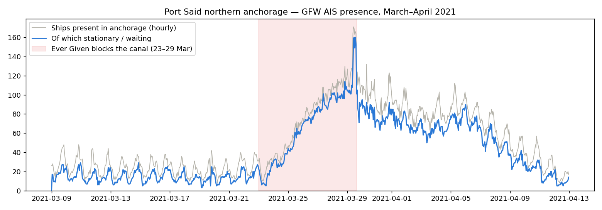

# Global Fishing Watch — Validation for Port Said, Suez and Alexandria

*Tests run on 2026-10-07. Data: Global Fishing Watch AIS vessel presence (`public-global-presence`, v4). **Powered by Global Fishing Watch** (globalfishingwatch.org), CC BY-NC 4.0, non-commercial use.*

## Why this test

No free *live* AIS feed covers Egyptian waters: aisstream.io and Open Waters were tested and show 0% coverage. GFW combines satellite and terrestrial AIS and is free for non-commercial research, but it had to prove three things before we adopt it (decision D-008):

1. Does it actually see ships at Port Said every hour?
2. How late does the data arrive?
3. Does it capture a **known** congestion event?

## Method

- **API:** 4Wings report, `spatial-resolution=HIGH` (0.01° ≈ 1 km cells), `temporal-resolution=HOURLY`, `group-by=VESSEL_ID`.
- **Output:** one row = one vessel in one cell during one hour.
- **Areas (exploration boxes, to be replaced by proper anchorage zones):**

| Area | Longitude | Latitude |
|---|---|---|
| Port Said box (port + approaches + anchorage) | 32.10–32.60 | 31.20–31.60 |
| Port Said northern anchorage | 32.10–32.60 | 31.32–31.65 |
| Alexandria box (Alexandria + Dekheila + anchorage) | 29.65–30.05 | 31.08–31.40 |

- **"Waiting" vessel:** a vessel in the **same 0.01° cell as its previous hour** (≤ 2 h gap), i.e. stationary or anchored.

## Results

### 1. Coverage at Port Said (2026-09-25, Port Said box)

| Metric | Value |
|---|---|
| Vessel-hours | 2,746 |
| Distinct vessels | 197 |
| Vessels present per hour | min 92 · median 113.5 · max 133 |
| Hours with data | **24 / 24** |
| Vessels stationary all day (≥ 6 h, ≤ 2 cells) | 60 (e.g. STI BRIXTON, WYRALON, FORWARDER, TRANSFORMER in the northern anchorage) |

### 2. Latency

On 2026-10-07 the newest available day was **2026-10-02**, so data arrives **~5 days late**. GFW's API documentation states availability "2017 to approximately 5 days ago".

### 3. Known event: the Ever Given blockage (23–29 March 2021)

Port Said northern anchorage, 9 March – 12 April 2021: 44,014 vessel-hours, 1,731 vessels, **840 / 840 hours with data**.

| Period | Waiting vessels (daily mean of hourly counts) |
|---|---|
| Normal (9–22 Mar) | **~14.5**, with a clear daily up-and-down rhythm (the canal convoy cycle) |
| 24 Mar | 31.0 |
| 26 Mar | 75.9 |
| 28 Mar | 100.2 |
| 29 Mar (ship freed) | 110.6 daily mean; **hourly peak 160 at 11:00 UTC** |
| 1 Apr | 75.3 |
| 6 Apr | 70.7 |
| 9 Apr | 31.5 |
| 12 Apr | 9.2 (back to normal) |

The build-up, the peak on the day the canal reopened, and the ~2-week clearance match the public timeline of the event.

### 4. Coverage at Alexandria (26 Sep – 2 Oct 2026, Alexandria box)

| Metric | Value |
|---|---|
| Vessel-hours | 12,621 |
| Distinct vessels | 209 |
| Hours with data | **168 / 168** |
| Vessels per hour | ~48 inside the ports, ~27 outside (≈ 22 stationary outside) |
| Cross-check with the Port Authority board | 12 of 19 recent commercial board ships found in GFW by IMO |

The Port Authority board shows only 1 ship at the inner anchorage, while GFW sees ~22 stationary outside the port. **The two sources describe the port differently**, so a 4–6 week side-by-side overlap is planned before GFW-trained models are fed board data live (decision D-008).

## Limitations

- **Not live:** ~5 days late. It's used for training and backtesting; live Port Said forecasts would need a live AIS feed.
- **Coarse vessel types:** 57% of vessels on the Port Said test day were typed "OTHER" (including a known tanker). Types must be enriched before separating cargo/tankers from tugs and service craft.
- **Resolution:** one position per vessel per hour, ~1 km cells. That's adequate for anchorage-level queues, but not for berth-level detail.
- **Satellite reception** can miss vessels in dense areas. No missing hours were observed, but per-vessel completeness still needs checking against SCA/PortWatch.
- **Simple stationary rule:** to be replaced by anchorage zones (DBSCAN + the GFW anchorages dataset) and proper episode logic.
- **License:** non-commercial only. A commercial product would need another source.

## Verdict

**GFW is adopted as the training, label and backtest source for Port Said / Suez** (and as history for Alexandria). It passes coverage (24/24 h) and the Ever Given test. It is **not** a live source.

**Next steps:**
1. Backfill Port Said 2017 → now.
2. Run a daily incremental pull.
3. Define anchorage zones.
4. Enrich vessel types.
5. Validate daily counts against SCA bulletins and PortWatch.
